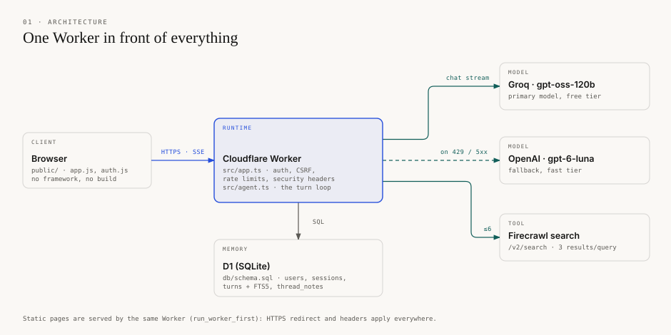
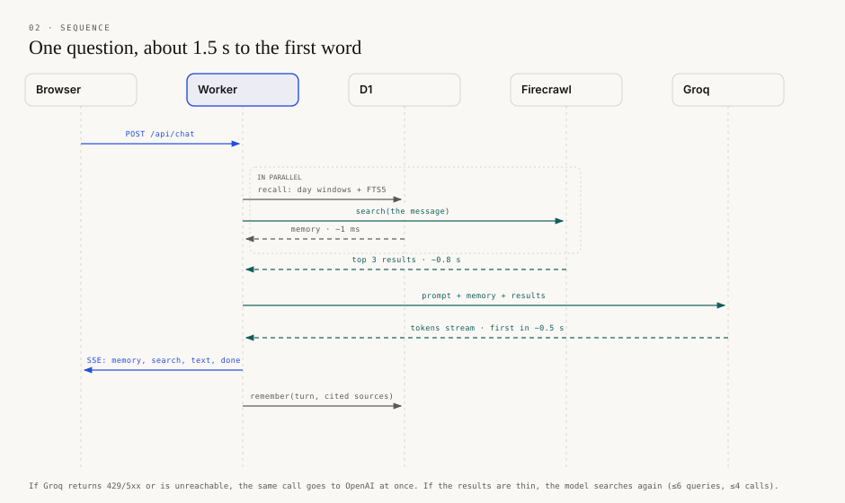
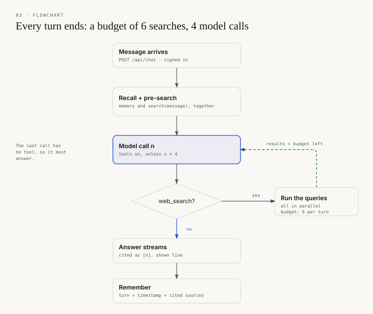
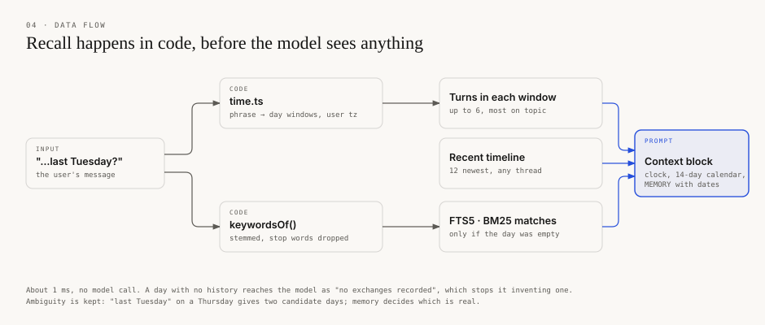
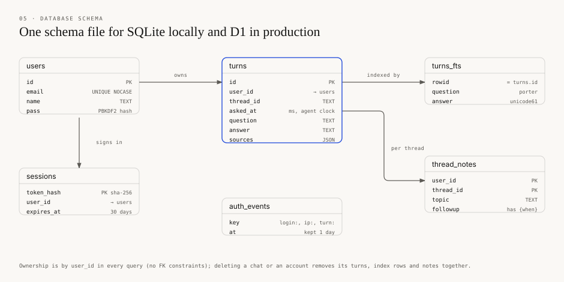

# Remembot: design

The brief: answer fast, get things right, remember what was asked and when. Its sample questions share one shape: **a time phrase, a past exchange, a fresh look at the web, a diff.** Everything below follows that shape.

The diagrams are drawn with the grammar of [diagram-design](https://github.com/cathrynlavery/diagram-design) in Remembot's own palette. Rebuild them with `python docs/diagrams/build.py`.

**Contents:** [Architecture](#architecture) · [One turn](#one-turn) · [The agent loop](#the-agent-loop) · [Memory recall](#memory-recall) · [Data model](#data-model) · [Why this way](#why-this-way) · [Considered and rejected](#considered-and-rejected) · [With another week](#with-another-week)

## Architecture

- **One Worker in front of everything** (`src/worker.ts`, `run_worker_first`). Pages and API share one HTTPS redirect, one set of security headers, and the sign-in redirect.
- **One codebase, two runtimes.** `src/app.ts` is a plain `Request -> Response` handler. `src/node.ts` (node:sqlite) and `src/worker.ts` (D1) wrap it and run the same SQL from [`db/schema.sql`](db/schema.sql).
- **Two model providers, one interface.** Groq's `gpt-oss-120b` answers first (free tier, about 0.5 s to the first token). If it returns 429 or 5xx, or cannot be reached, the same call goes to OpenAI's `gpt-6-luna` at once (`createChat(primary, fallback)`).

## One turn

The first word arrives in about 1.5 s:

| Step | Time |
|---|---|
| Recall from SQLite | about 1 ms |
| Firecrawl search for the message itself (pre-search) | about 0.8 s |
| Groq to the first token | about 0.5 s |

The pre-search runs beside recall, so most answers take one model call instead of two. Questions about past chats ("What did I ask…") skip it, because searching their words only finds noise.

## The agent loop

`src/agent.ts`, under 200 lines, no framework. A turn has a budget of **6 search queries and 4 model calls**. After each search the model is told what is left. The last call has no tool, so every turn ends.

## Memory recall

- **Recall is code, not a tool** (`src/time.ts`, `src/memory.ts`). Time phrases become day windows in the user's time zone. SQLite returns the exchanges inside them and the 12 most recent questions. If the named day holds nothing, the best keyword matches from other dates are offered instead (FTS5, BM25, stemmed).
- **The model reads dates; it never computes them.** It sees the clock, a 14-day calendar and that memory.
- **Fresh and remembered values keep their own dates.** A search can return something older than a remembered answer, such as a previous close. The prompt forbids calling the older one "now".

## Data model

- **Passwords** are PBKDF2-SHA256 with a per-user salt, at 100k iterations, the most Workers allows.
- **Session tokens** are 256-bit and stored only as SHA-256 hashes.
- **Guest accounts** store no password hash, so no password can ever sign in to them. Ending a guest session deletes the account.
- **`auth_events`** backs every rate limit: sign-ins per email+IP, per IP and per email; sign-ups and guests per IP; daily questions per user and in total. Each attempt is recorded *before* it is counted, so a burst of parallel requests cannot slip under a limit.
- **`thread_notes`** caches each returning-user card. The follow-up question stores `{when}`, which is filled at display time ("earlier today", "yesterday", "on 10 Nov"), so a card never goes stale.

## Why this way

- **Memory is context, not a tool.** The brief allows one tool. Recall in code also saves a model round trip on every message, and the model cannot forget to look.
- **Ambiguity is kept, not guessed.** "Last Tuesday" said on a Thursday yields two candidate days; "3/11" yields 3 Nov and 11 Mar. Memory settles it, and the answer opens with the real date. A day with no history reaches the model as "no exchanges recorded", which stops it inventing a conversation.
- **Every answer is a dated snapshot.** "Is that still correct?" needs the old answer, its sources and its date. The model re-checks those facts and reports old value, new value, and what it could not verify.
- **Queries are a list, not parallel tool calls.** Some models emit one tool call per step. A list argument works on every model, and all its queries run at once.
- **Speed came from measuring, not guessing.** Each stage was timed before anything changed:
  - The pre-search removed a whole model round trip.
  - Firecrawl's highlights and domain-tool lookups tripled each search (about 2.3 s, down to 0.8 s without them), so they are off.
  - Groq's `gpt-oss-120b` beat `gpt-oss-20b` on real prompts: the smaller model reasons longer on the full context.
- **Failure is said out loud.** A failed search reaches the model as "Search failed", so the answer says "unverified" instead of filling the gap. Fallbacks are logged.
- **The clock is injected** (`Deps.now`). Tests pin it, a request can carry `now` to replay a dated conversation, and `/api/demo` replays three real questions at past dates.
- **The interface shows the time model.** Memory is on screen: 14 day bars and chats grouped by day. Each answer leads; what was recalled and searched folds into one line above it. Two tags carry the semantics: Amber Bookmark marks the past, Oxidized Verdigris the live web.
- **Editorial, not decorative.** Archival paper, carbon ink and one cobalt accent, in light and dark. The sign-in page and the welcome screen sit on a framed public-domain Turner. Motion is kept to what explains: the mark drawing in, pulsing dots before the first word, cards settling. All of it is off under reduced motion. The brand kit is in [`docs/brand/`](docs/brand/README.md).
- **No build step.** The UI is plain HTML, CSS and JS in `public/`; Motion is vendored as one file. The server is about 1,350 lines of TypeScript with one runtime dependency, `chrono-node`, to spot date phrases.

## Considered and rejected

- **Memory as a second tool, or a router model choosing memories.** One more round trip per message, and date maths done by a model.
- **Embeddings.** An extra key and network call per message. Time windows, BM25 and an always-visible timeline cover a personal history. The ceiling (pure paraphrase of old turns) is marked in the code.
- **Always showing topic matches from other dates.** Built it, then removed it: next to the right exchange, a second dated one made the model quote the wrong date.
- **A `since` date filter on the tool.** Built it, then removed it: the model applied it to ordinary lookups and filtered out the pricing pages it needed. The period goes in the query text.
- **Scraping full pages.** Better on some pricing tables, seconds slower on every search.
- **A cheaper OpenAI model.** `gpt-6-luna` is OpenAI's cheapest. The nano variants cost twice as much, and `gpt-5-nano` invented a past chat in testing.
- **An agent framework.** The loop is short; a framework would hide the part being judged.
- **A React UI kit.** Patterns from SmoothUI, tactileui and Motion's examples are ported to plain CSS and JS, so nothing needs building.

## With another week

- An eval set of dated, multi-day conversations run through the replay clock, scored on date accuracy, recall hits and citation validity, then tuned by numbers instead of by feel.
- Let the model open one page when excerpts are too thin; cache searches for a few minutes so follow-ups cost nothing.
- Purge guest accounts nobody has used for a week; seed a new guest with one dated exchange so recall can be tried straight away.
- IANA time zones for daylight-saving accuracy; embeddings and monthly summaries once histories get long.
