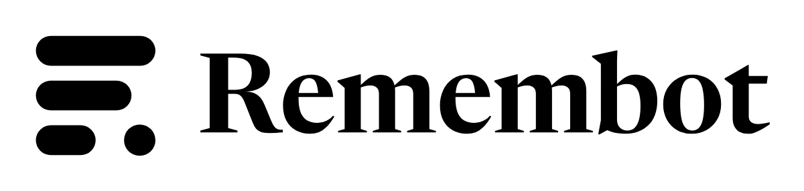

# Remembot brand kit

**Strata.** Three layers of dated answers, the newest shortest; the crimson dot is *now*. Memory as layers in time, not a clock, a brain or a sparkle.

## Files

| File | Use |
| --- | --- |
| `remembot-symbol.svg` | Master symbol, two colours (ink layers, crimson dot) |
| `remembot-symbol-small.svg` | Small-size cut for 16–32 px: thicker layers, wider gaps |
| `remembot-symbol-reversed.svg` | On dark backgrounds |
| `remembot-horizontal.svg`, `-reversed.svg` | Symbol + wordmark, side by side (the default lockup) |
| `remembot-stacked.svg` | Symbol above wordmark, for square spaces |
| `export/` | One-colour black, white and crimson versions, square and app-icon SVGs, PNGs, `favicon.ico`, the web icon set and `site.webmanifest` |
| `presentation.html`, `slides/` | Presentation board with mockups |
| `concepts/` | The three concepts this was chosen from |

The wordmark is set in **Newsreader SemiBold** (opsz 72, tracking −1 %) and outlined to paths, so no font is needed to display it. Newsreader is licensed under the SIL Open Font License 1.1, which allows logo use.

## Clear space and size

- **Clear space:** one layer height on every side (40 units on the 256 grid, about 16 % of the symbol). Nothing enters it.
- **Minimum size:** symbol 16 px (use the small cut below 32 px); horizontal lockup 96 px wide; stacked lockup 64 px wide.

## Colour

| Name | Role | HEX | RGB | CMYK (approx.) |
| --- | --- | --- | --- | --- |
| **Ink** | Layers, wordmark, text | `#1B1A17` | 27 26 23 | 0 4 15 89 |
| **Now** | The dot; the only accent | `#B42D43` | 180 45 67 | 0 75 63 29 |
| **Paper** | Light background | `#FAF8F4` | 250 248 244 | 0 1 2 2 |
| **Linen** | Panels on paper | `#F3F0EA` | 243 240 234 | 0 1 4 5 |
| **Stone** | Secondary text | `#6E6A62` | 110 106 98 | 0 4 11 57 |
| **Night** | Dark background | `#1A1917` | 26 25 23 | 0 4 12 90 |
| **Bone** | Layers and text on Night | `#EEEAE3` | 238 234 227 | 0 2 5 7 |
| **Now (dark)** | The dot on Night | `#E8667A` | 232 102 122 | 0 56 47 9 |

Contrast: Ink on Paper 16.4:1, Stone on Paper 5.1:1, Now on Paper 5.8:1, Bone on Night 14.7:1, Now (dark) on Night 5.5:1. All pass WCAG AA. No Pantone match has been verified; match Now visually on press.

**Rule of one accent.** Now marks the present: the dot, the primary action, today in a timeline. Everything else is Ink, Stone and Paper.

## Type

- **Newsreader** (serif): wordmark, greetings, long-form answers.
- **Geist** (sans): interface labels, buttons, short text.
- **Geist Mono**: times, counts and readouts only.

## Approved backgrounds

Paper, Linen and white take the two-colour mark. Night and photography darker than 40 % take the reversed mark. Anywhere else, use one-colour black or white.

## Don't

- Recolour the layers, or make the dot any colour but Now.
- Add a fourth layer, reorder the layers, or move the dot off the last line.
- Stretch, rotate, outline, add shadows or gradients, or set the wordmark in another font.
- Use the master symbol below 32 px (use the small cut).

## Notes

- Trademark clearance has not been checked. Run a professional search (trademark databases, reverse image search) before registering.
- Rebuild the marks with the script that made them: geometry is on a 20-unit grid, one radius per bar (half its height), the dot carries a 1-unit overshoot.
